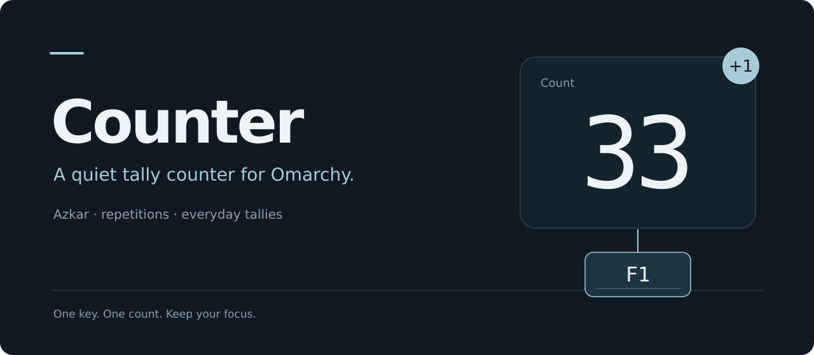
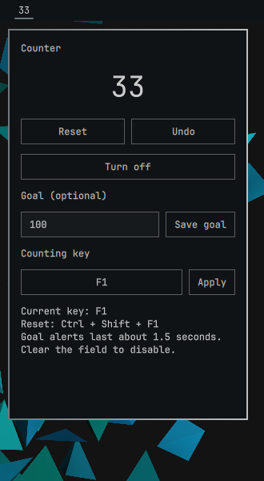

# Counter — a quiet tally counter for Omarchy

A minimalist tally counter for azkar (Islamic remembrance), repetitions and everyday counting. Reserve one key to add a count without switching windows or opening a popup.

The bar shows only the number. Click it for Reset, Undo and a key chooser: click the displayed key, press your preferred key, then Apply. Your total and selected key stay saved across restarts.

**[Install Counter](#-installation)** · Built for Omarchy's native Quickshell plugin system.



*The real panel, captured in an isolated Omarchy session. Its appearance follows your desktop theme.*

##  Features

- **Count without changing focus.** The chosen key adds one silently; holding it does not repeatedly count.
- **Choose the key by pressing it.** The chooser captures your selection, checks desktop shortcut conflicts and lets you review it before applying.
- **Correct or restart a tally.** Undo subtracts one without going below zero. Reset explicitly starts again at zero.
- **Keep your place.** Locked, atomic saves preserve the total and key; updates and removal retain your data for reinstalling.
- **Use the same tally across monitors.** One service owns the binding, even when several bars display the count.

##  Installation

Tested with **Omarchy 4.0.4**, **Hyprland 0.56.2** and **Quickshell 0.3.1**. Counter requires the Lua binding API and Quickshell's Wayland shortcut inhibitor; older Hyprlang-only desktops are unsupported. Python 3.11+, `libxkbcommon` and `hyprctl` must be available. No extra Python packages are needed.

```sh
omarchy plugin add https://github.com/yaqyn/omarchy-counter.git --enable
```

A number appears in your bar. **F1 is the default counting key**, so its usual app action is reserved for counting while Counter is enabled. Existing desktop shortcuts are preserved: if F1 conflicts, open the panel and choose another key.

There is no installer script, root access, separate executable installation or permanent edit to your Hyprland configuration. Newer desktop versions may work, but changes to Omarchy's shared UI components can require maintenance.

##  Quick start

1. Press **F1** once. The number in the bar increases by one, without opening the panel.
2. Click the number to see the controls.
3. To change the key, click **F1**, press your preferred key, then click **Apply**. Escape cancels selection.
4. Use **Undo** to correct one press or **Reset** to start a new tally.

The key is consumed before reaching your apps, including when Shift, Ctrl or Alt is held. Modifier keys alone cannot be selected; Escape is reserved for cancelling the chooser. Login/lock screens and apps that inhibit global shortcuts are outside this active-session guarantee.

To stop reserving the key:

```sh
omarchy plugin disable yaqyn.counter
```

##  Usage

### Update or remove

```sh
omarchy plugin update yaqyn.counter
omarchy restart shell

omarchy plugin enable yaqyn.counter
omarchy plugin remove yaqyn.counter
```

Restart the shell after an update to clear cached QML components. Disabling and removing the plugin release the counting key. Your saved total and key remain available if you reinstall.

### Troubleshooting

| Symptom | Check and remedy |
| --- | --- |
| Key already used | Choose another key. A shortcut using the same key with any modifier conflicts because Counter ignores modifiers. Physical keycode shortcuts currently require a manual conflict check. |
| Capture unavailable | Close and reopen the panel. The compositor must grant the shortcut inhibitor; selection fails safely if it cannot. |
| Saved count unreadable | Inspect or back up the `count` file before Reset. Write failures can indicate full storage or incorrect permissions. |
| Key unavailable after a change | Read the inline error and check `hyprctl configerrors`. Resolve desktop/dependency errors, then restart the shell. |

##  Configuration

Use the panel to choose the key. Persistent files live in `${XDG_STATE_HOME:-$HOME/.local/state}/counter`:

| File | Purpose |
| --- | --- |
| `count` | Saved nonnegative total |
| `settings.json` | Versioned counting-key preference |
| `service.json` | Local service status for the panel |

Invalid count data is preserved until you explicitly Reset. To erase all saved data, remove this directory **after** removing the plugin. Disabling or removing Counter alone keeps it.

##  Architecture

`Service.qml` starts one event-driven Python helper for the compositor. It registers the chosen key through Hyprland's Lua API and listens for desktop reloads through the event socket, without polling. Each press runs `counter.py increment`; the bar observes the saved count file.

For a batch entry, run `python counter.py add 25`; it updates the same locked counter and prints the new total.

Key changes validate conflicts, verify the new binding and roll back the previous runtime key and settings if the change fails. Ownership tokens keep old teardown from removing a newer binding. Cleanup calls `hyprctl` directly, so it still works after the plugin directory disappears during removal.

| Source | Responsibility |
| --- | --- |
| [BarWidget.qml](BarWidget.qml) | Numeric label, state observation and panel lifecycle |
| [Panel.qml](Panel.qml) | Native controls, capture and inline feedback |
| [KeyCapture.js](KeyCapture.js) | Translate Qt key events into XKB key names |
| [Service.qml](Service.qml) | Singleton helper lifetime and removal cleanup |
| [counter.py](counter.py) | Persistence, validation and binding ownership |

##  Verification

Get the source, then run the checks from its root:

```sh
git clone https://github.com/yaqyn/omarchy-counter.git
cd omarchy-counter

PYTHONDONTWRITEBYTECODE=1 python3 -m unittest discover -s tests -v
/usr/lib/qt6/bin/qmltestrunner -platform offscreen -input tests/qml
omarchy plugin validate .
uvx --from ruff==0.17.1 ruff check .
uvx --from ruff==0.17.1 ruff format --check .
```

Qt's test runner and `uv` are optional development tools, not runtime requirements. The local suite covers concurrent presses, corrupted state, permission/disk failures, shortcut conflicts, rollback and Qt key mappings.

For native install/update/removal, two outputs, helper recovery and desktop restart checks:

```sh
python3 tests/desktop.py --run --keep
```

This opt-in test starts a **nested desktop window**, private D-Bus session and temporary configuration. It does not reset your live counter. It requires an active Wayland desktop and the Omarchy tools; `--keep` retains logs at the printed path.

See [verification coverage](docs/VERIFICATION.md) for tested versions, evidence and remaining hardware checks. Build a deterministic archive from a clean committed checkout with `python3 scripts/release.py`.

##  Security and limitations

Counter needs no network connection, credentials or telemetry during normal use. Like other Omarchy plugins, it runs with your user permissions rather than in a sandbox. The chooser temporarily inhibits desktop shortcuts only while listening for a selection.

The tested desktop combination is documented above. Physical reboot, mixed-DPI hardware, different keyboard models and full non-Latin-layout interaction still need broader verification; Qt's non-Latin key-name mapping has automated coverage. See the [verification record](docs/VERIFICATION.md) before making compatibility assumptions.

##  Contributing

Read [CONTRIBUTING.md](CONTRIBUTING.md) and [DESIGN.md](DESIGN.md). Keep ordinary counting silent, preserve the existing controls and add regression coverage for behavior changes. Report bugs through [GitHub issues](https://github.com/yaqyn/omarchy-counter/issues), with desktop versions and reproducible steps; omit private screenshots and full environment dumps.

##  License

[MIT](LICENSE) · Built and maintained by Abdulrahman M. Yaqyn.
